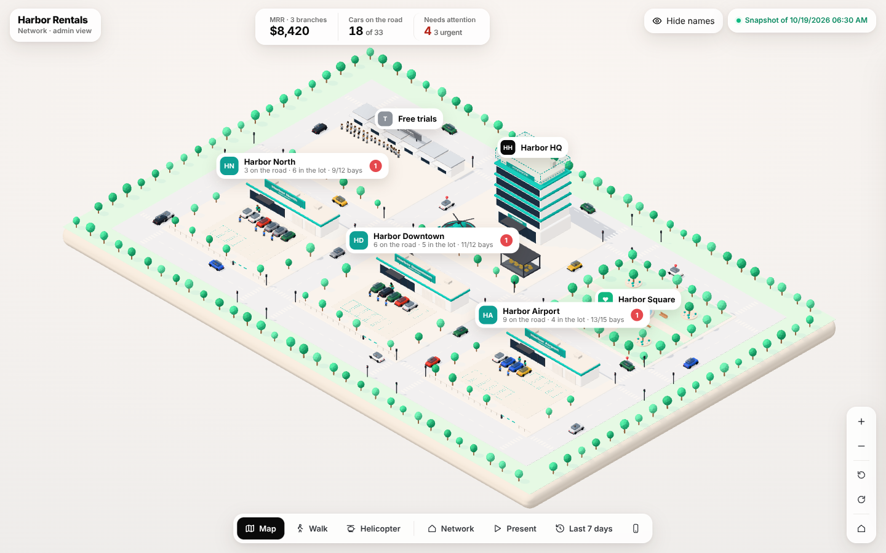
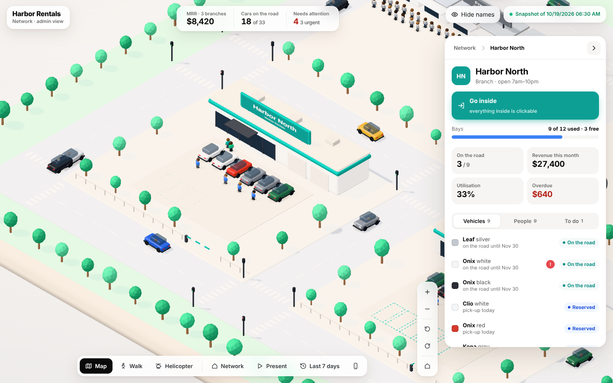
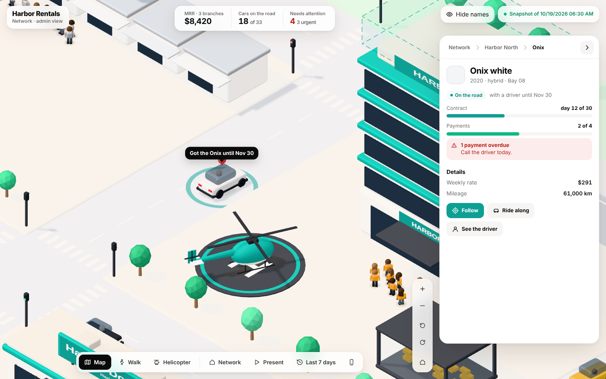
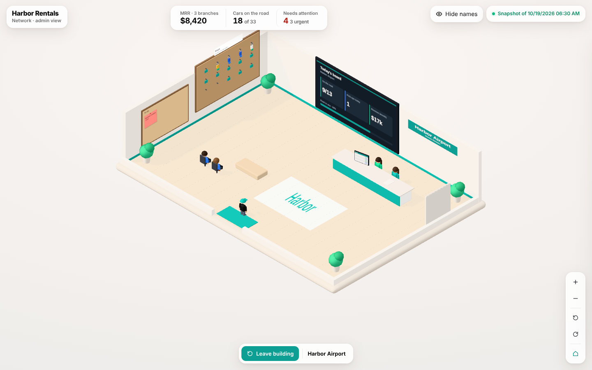
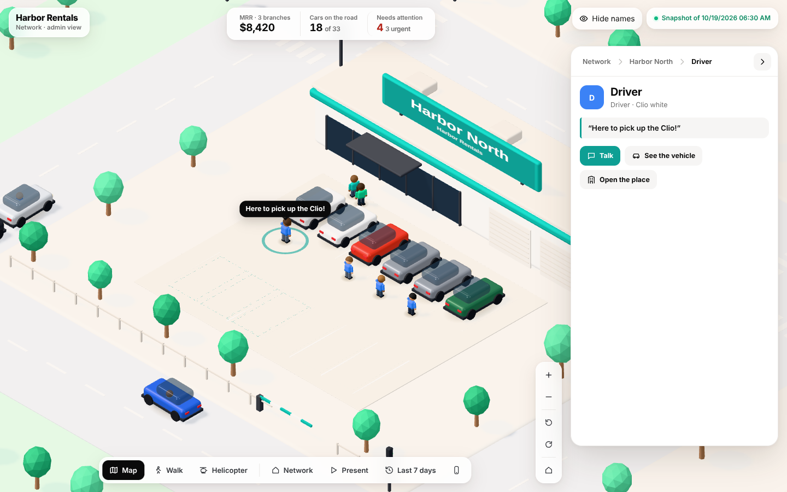
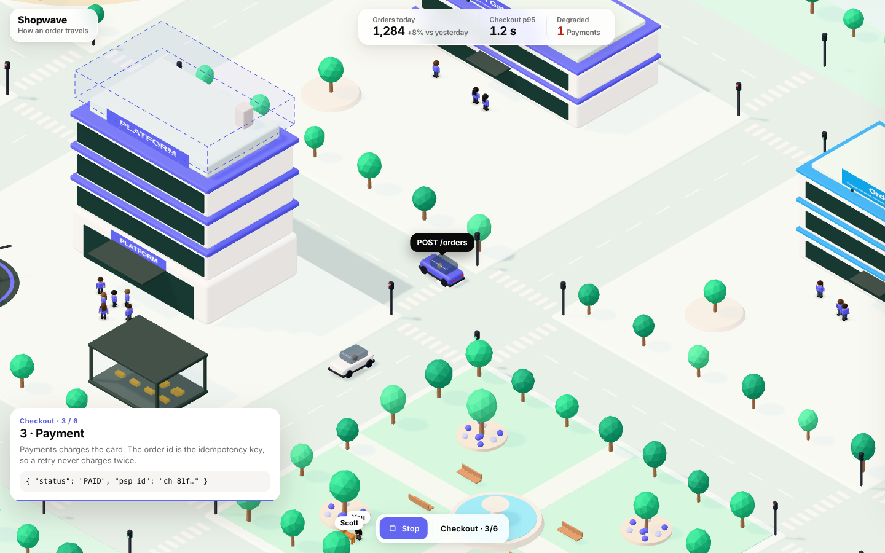
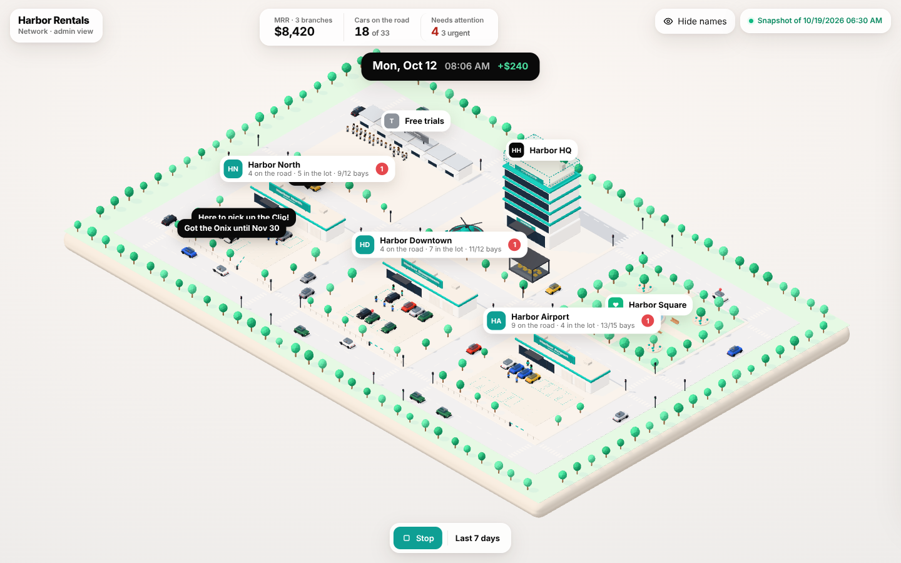
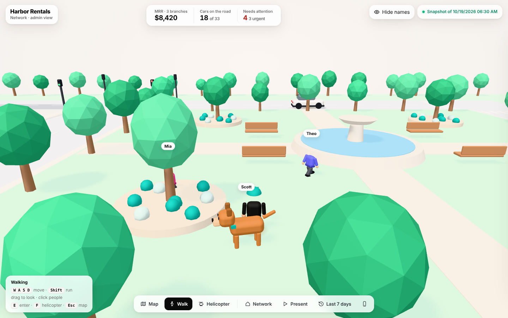
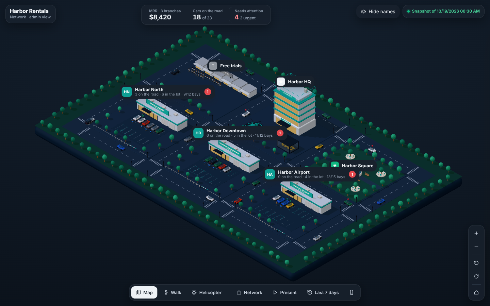

# City of Living Data

[](../STATS.md)


**Turn your business, your SaaS or your system into a living 3D city — where everything is clickable.**

An Agent Skill. Point it at your data (or your repo) and the AI first **understands** what you
have, then **designs** the city with you, then **generates** it: one building per place, cars
that drive when they're in use, a little person for every user, a panel that tells you what
needs attention today — and you can walk into every building.



## Everything answers a click

| Click a place → its numbers, what's pending, who's there | Click a car → its rental, its alerts; the driver talks |
|---|---|
|  |  |
| **Walk into any building** — keys on the board, notes on the cork board, people at the counter: all clickable | **Every person reacts** — turns, waves and says something true |
|  |  |

## Three ways to use it

| | You get |
|---|---|
| **Monitor** | Places, vehicles and people bound to real data. A car on the road = in use; a reserved car has its driver waiting next to it; the HQ gains a floor per revenue step; a vault fills with a gold bar per open deal; people who used the product this week walk, the others stand still. KPIs with comparisons, a ranked "Needs attention" list, live updates or a snapshot, **Hide names** for recordings. |
| **Explain** | **Journeys**: step-by-step captions while a courier car drives a request between your services, with payload examples and failure steps that turn a service red. Great for onboarding and docs. |
| **Present** | **▶ Present** (an automatic tour built from your data), **a week replayed in a minute**, and a **9:16 frame** for Reels/TikTok/Shorts. |

| Explain: a journey through your services | Present: 7 days in 60 seconds |
|---|---|
|  |  |
| **Walk around with your avatar — and Scott, the dog** | **Night palette, phone layout** |
|  |  |

## Install

**Claude (web / desktop):** download `city-of-living-data.zip` from the
[latest release](https://github.com/lorransantosdev/utils/releases), then **Customize → Skills →
+ → Upload a skill**.

**Claude Code:**
```
/plugin marketplace add lorransantosdev/utils
/plugin install city-of-living-data@lorran-utils
```
or copy this folder to `~/.claude/skills/city-of-living-data/`.

Then just ask: *"turn my Supabase into a living city"*, *"make a 3D city of our microservices
that explains checkout"*, *"cidade 3D da minha empresa para gravar um vídeo"*.

## How it works: understand → design → generate

1. **Understand** — the goal first (Monitor · Explain · Both · Other); then it reads before it
   asks: your files, your repo (`scripts/discover.py` finds services, databases, queues and who
   calls whom), your database (read-only). It asks only what's missing and writes an
   *Understanding Summary* for you to correct.
2. **Design** — a one-page *City Brief*: what becomes a shop, an office, the HQ; what the cars
   mean; what each person says; which numbers, from where, how fresh. You approve it.
3. **Generate** — `world.json` (or a small converter from your data), validation (errors,
   privacy, "is everything interactive?"), your format, then visual QA in a headless browser.

## What you get

- **One HTML file** (double-click, e-mail, publish), a **static site**, or a **component** for
  React/Next, Vue/Nuxt or Angular (Svelte snippet in the docs).
- A city drawn from one `world.json` — no coordinates, no code changes.
- Data from `http`, `supabase` (anon key + RLS), `sse`, `ws` or `static` sources, or pushed with
  `city.update(patch)`. Read-only, no secrets in the browser.
- English and Portuguese built in; any other language through `meta.text`.

```js
import { createCity } from './city-of-living-data.js';
const city = createCity(document.getElementById('city'), world);
city.open({ t: 'place', id: 'north' });   // fly there and open its panel
city.enter('north');                      // walk inside
city.update({ vehicles: [{ id: 'v2', state: 'parked' }] });   // the car drives back to its bay
```

## Folder

```
SKILL.md                 the instructions the AI follows
references/              world format, interaction, data sources, recipes, QA…
scripts/                 discover · validate · scaffold · snapshot · screenshot
assets/engine/           city-of-living-data.js (+ .css, .d.ts) — the engine, three.js only
assets/examples/         rental.world.json (monitor) · microservices.world.json (explain)
assets/template/         single-file and static-site shells
assets/integrations/     React, Vue and Angular components
```

## Credits

Made by [Lorran Sarmento](https://github.com/lorransantosdev). It started as the admin view of a
car-rental SaaS and grew into a skill anyone can use.
Scott, the dog in every city, is a tribute to mine. 🐾

MIT License.
